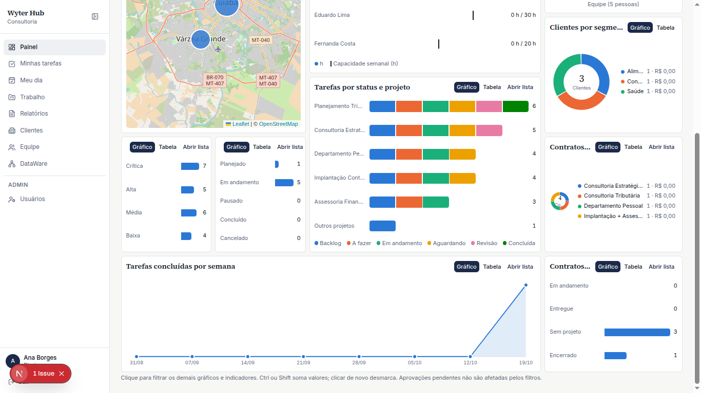
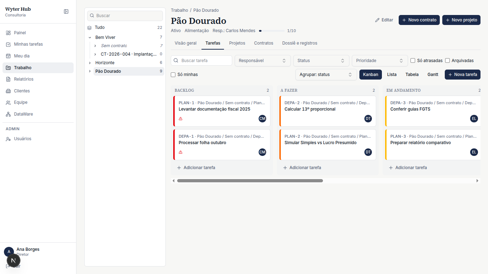
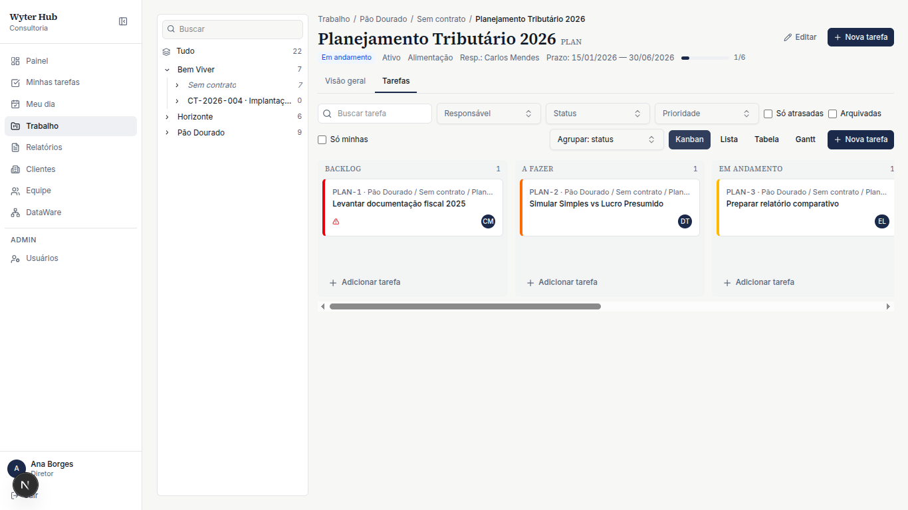
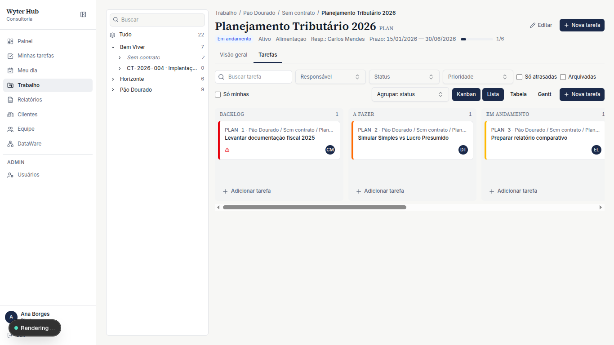
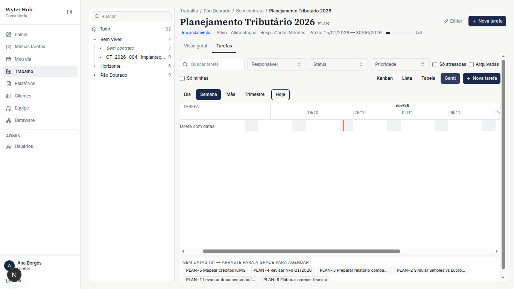
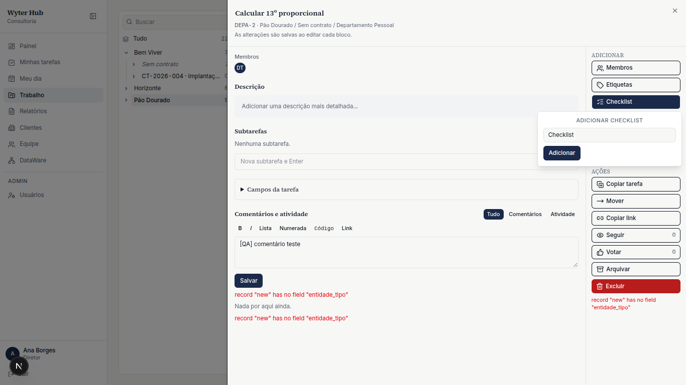
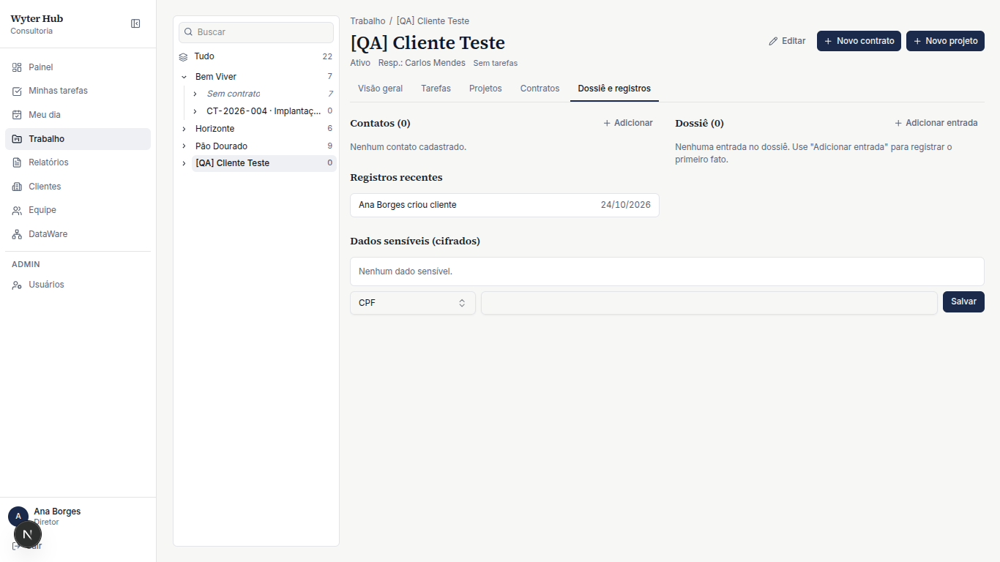
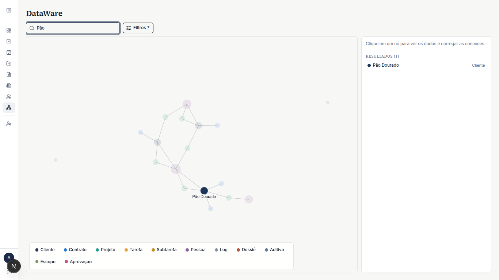
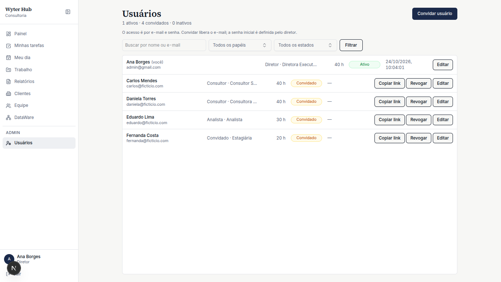
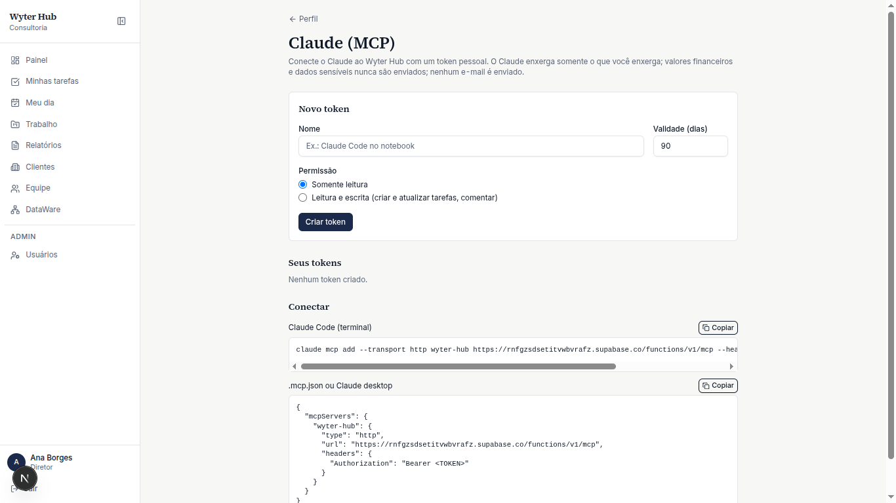

# Wyter Hub — Visão geral do sistema

Material visual para apresentar a ideia do Wyter Hub à direção da Wyter Consultoria.

Para uma apresentação em formato de onboarding, abra [onboarding.html](./onboarding.html) no navegador ou use a opção de imprimir para gerar PDF.

## 1. Painel gerencial

**Legenda:** visão executiva da operação, com indicadores, gráficos, carga da equipe, clientes, projetos e acompanhamento de resultados.

## 2. Área de tarefas

**Legenda:** central de trabalho para acompanhar tarefas de todos os clientes, contratos e projetos em um único contexto.

## 3. Kanban

**Legenda:** fluxo visual de execução, com tarefas organizadas por status e movimentação rápida entre etapas.

## 4. Lista de tarefas

**Legenda:** visão operacional para pesquisar, filtrar, agrupar e editar tarefas com mais densidade de informação.

## 5. Gantt

**Legenda:** planejamento temporal de projetos, prazos, dependências e entregas, facilitando a identificação de atrasos e conflitos.

## 6. Detalhe da tarefa

**Legenda:** espaço completo da tarefa para descrição, checklist, comentários, anexos, responsáveis, prazos e histórico de atividade.

## 7. Dossiê do cliente

**Legenda:** memória organizada de cada cliente, reunindo contexto, informações importantes, decisões, contatos e registros.

## 8. DataWare

**Legenda:** visão conectada dos dados da consultoria, relacionando clientes, contratos, projetos, tarefas, documentos e registros.

## 9. Gestão de usuários

**Legenda:** administração de pessoas, convites, papéis e permissões para manter cada informação acessível somente a quem precisa.

## 10. Ponte com Claude

**Legenda:** integração controlada com o Claude para consultar o Hub com o contexto e as permissões de cada consultor.

## Mensagem central

O Wyter Hub reúne operação, conhecimento, documentos, tarefas, indicadores e inteligência em um só lugar — substituindo a fragmentação entre Trello, Drive, Gmail e ferramentas de IA.
